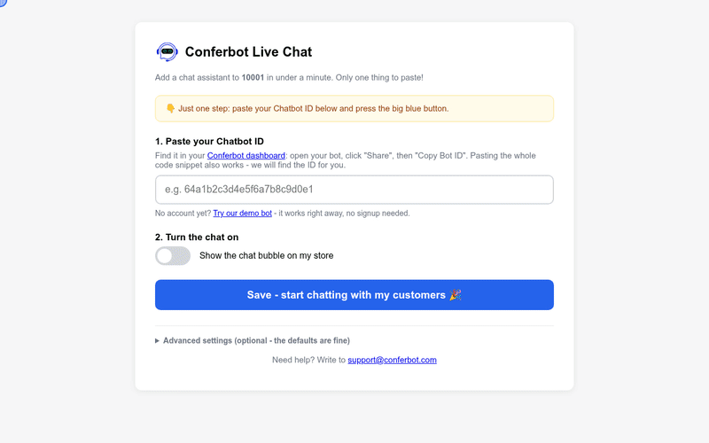

# Conferbot Ecwid App

Installs the [Conferbot](https://conferbot.com) AI chat widget on an Ecwid storefront. Same product as the other Conferbot integrations ([Shopify](https://github.com/Conferbot/conferbot-shopify), [BigCommerce](https://github.com/Conferbot/conferbot-bigcommerce), [Wix](https://github.com/Conferbot/conferbot-wix), [WordPress](https://github.com/Conferbot/conferbot-wordpress), [PrestaShop](https://github.com/Conferbot/conferbot-prestashop)), Ecwid-shaped: OAuth install, settings saved to the app's **public storage**, and a storefront loader that reads it via `Ecwid.getAppPublicConfig()`.

## See it in action



[HD video (MP4)](docs/demo.mp4)

## How it works

```
merchant installs from the Ecwid App Market
  -> Ecwid redirects to {APP_URL}/auth/callback?code=&store_id=
  -> code exchanged at POST my.ecwid.com/api/oauth/token/{store_id} -> access_token

merchant opens the app in the Ecwid admin
  -> Ecwid loads /app?payload=...   (AES-128 payload decrypted with the client secret)

merchant saves settings (/app -> /app/save)
  -> app writes { "value": "{botId, embedType, enabled, scriptUrl}" } to
     PUT app.ecwid.com/api/v3/{storeId}/storage/public

every storefront page load
  -> Ecwid loads {APP_URL}/storefront/loader.js (registered as the app's storefront JS)
  -> loader reads Ecwid.getAppPublicConfig(<client_id>), adds
     https://cdn.conferbot.com/dist/v1/widget.min.js (id "conferbot-js") and boots
     window.ConferbotWidget(botId, embedType, { customData: { platform: "ecwid", storeId }, user? })
  -> Ecwid.OnOrderPlaced  -> ConferbotWidget.track("purchase", { value, currency?, order_id })  (once per order)
  -> Ecwid.OnCartChanged  -> ConferbotWidget.track("add_to_cart")                              (when items are added)

merchant uninstalls
  -> Ecwid POSTs application.uninstalled to {APP_URL}/webhooks
     (X-Ecwid-Webhook-Signature checked) -> the store's token and settings are deleted
```

The logged-in customer (from `Ecwid.Customer.get`) is passed as the visitor, unverified: a storefront script cannot hold the identity verification secret. Orders and add-to-cart are reported so Conferbot can credit a sale to the chat that led to it.

The settings page opens only for the store's own admin: from the encrypted `payload` Ecwid adds when it opens the app, or with the short-lived token from the install, and every save carries a token signed with the client secret. A bare `?storeId=` is refused.

Everything visitors see is set per bot in the Conferbot dashboard and delivered at runtime, with nothing to configure in the store: flows and AI agents, live chat with handover to your team (queue position, leave a message when nobody is free, read receipts, file sharing, post-chat rating), the home screen, themes and dark mode, colours, launcher and mascot, greetings, languages and disabled URLs.

The only merchant-facing setting is the **Chatbot ID** (bare ID, full snippet, or URL - auto-extracted), with a one-click **demo bot** (`691c970890527a0468f9b2c9`) that works without a Conferbot account.

## Install guide (merchants)

### Requirements

- An Ecwid store (Lightspeed E-Series) on a plan that allows App Market apps. The chat works on the Instant Site and on any site where the Ecwid store is embedded.
- A Conferbot account and a bot ([app.conferbot.com](https://app.conferbot.com)), or the built-in demo bot to try it first.

### 1. Install the app

- **From the Ecwid App Market:** the listing is not live yet. Until it is, Conferbot support sends an install link for the app.
- **From an install link:** open it while signed in to your Ecwid admin and click **Install**. Ecwid asks you to allow the app to read your store profile and save its settings (`read_store_profile`, `update_store_profile`), then opens the Conferbot settings page.

There is nothing to upload and no theme code to edit: Ecwid loads the chat on your storefront itself and stops loading it when you uninstall.

### 2. Find your Chatbot ID

1. Sign in at [app.conferbot.com](https://app.conferbot.com) and open the bot you want on your store.
2. Click **Share**, then **Embed into your website**.
3. The ID is the 24-character code inside `ConferbotWidget("...")` in the snippet, for example `64a1b2c3d4e5f6a7b8c9d0e1`. It is also in the address bar: `.../chatbot/<ID>/embed`.

You can paste the ID, the whole snippet or that URL; the app keeps only the ID.

### 3. Settings

Open **Apps > My Apps > Conferbot** in the Ecwid admin.

| Setting | What it does |
| --- | --- |
| **1. Paste your Chatbot ID** | The bot that answers on your store. "Try our demo bot" fills in the public demo bot. |
| **2. Turn the chat on** | Shows or hides the chat on the storefront. The app stays installed either way. |
| **How the chat appears** (Advanced) | **Floating chat bubble** (`live_chat`, recommended) or **Popup window** (`popup_chat`). |

Press **Save**. The settings are written to the app's public storage in Ecwid, which the storefront reads on the next page load. Greetings, colours, languages, where the bubble sits and which URLs it hides on are set on the bot in the Conferbot dashboard.

### 4. Check it works

1. Open your storefront in a private window and wait a few seconds: the chat bubble appears in the corner.
2. Click it: the bot greets you. Send a message and the conversation shows up in the Conferbot dashboard under **Live Chat**.
3. Sign in as a customer and open the chat: the team sees that customer's name and email beside the conversation.

### Troubleshooting

| Symptom | Fix |
| --- | --- |
| No bubble after saving | Reload the storefront (Ecwid caches app files for a short time). Check the switch is on and the ID is 24 characters. |
| "Ecwid rejected the config update" on save | The app lost access to the store (reinstalled elsewhere or token revoked). Uninstall and install the app again. |
| "Open Conferbot from your Ecwid admin" | The settings link expired. Open the app again from **Apps > My Apps**. |
| Bubble missing on some pages | Check **Disabled URLs** and **Show on** (desktop / mobile) on the bot in the Conferbot dashboard. |
| Two chat bubbles | The Conferbot snippet is also pasted into the site's code. Remove one; the widget mounts once either way. |

### Uninstall

**Apps > My Apps > Conferbot > Uninstall.** Ecwid stops loading the storefront script and removes the app's storage. The app deletes the store's token and settings when it receives Ecwid's `application.uninstalled` webhook. Your bot and its conversations stay in your Conferbot account.

## Project layout

```
public/loader.js       # THE storefront file registered in the Ecwid dev portal
src/
├── index.js           # entrypoint
├── server.js          # /auth/callback, /app, /app/save, /webhooks, /storefront/loader.js
├── config.js          # env config (ECWID_OAUTH_BASE/ECWID_API_BASE overridable for tests)
├── ecwid.js           # OAuth token exchange, public storage write, payload + webhook verification
├── widgetScript.js    # bot ID helpers + public-config shape
├── adminPage.js       # two-step settings page
└── store.js           # JSON-file store (swap for a real DB)
test/e2e.test.js       # journey against mock Ecwid + browser widget mount
```

## Self-hosting the app (developers)

1. Register the app with Ecwid ([Developer Portal](https://my.ecwid.com/#develop-apps)) and ask Ecwid for these app settings:
   - `redirectUrl`: `{APP_URL}/auth/callback` (Ecwid now sends `code` and `store_id`; the code is exchanged at `/api/oauth/token/{store_id}`)
   - scopes: `read_store_profile update_store_profile customize_storefront add_to_cp` (`src/config.js`). Writing the public storage needs `update_store_profile`; Ecwid only loads the storefront JS (`customJsUrl`) with `customize_storefront`, and the native settings page (`iframeUrl`) needs `add_to_cp`. Scopes are set on the app, and changing them later makes every store reinstall, so ask for all four up front. The install callback logs a warning when a token comes back without one of them.
   - native app page (`iframeUrl`): `{APP_URL}/app`
   - storefront JS (custom JS URL): `{APP_URL}/storefront/loader.js`
   - `webhookUrl`: `{APP_URL}/webhooks`, events `application.uninstalled` and `profile.personalDataRemovalRequest`
2. Copy `.env.example` to `.env` with the client ID and secret. `ECWID_CLIENT_ID` must be the app's real `client_id`: the server writes it into `loader.js` for `Ecwid.getAppPublicConfig()`. `APP_URL` must be public HTTPS.
3. `npm install && npm start` (Node 18+), then install on your test store.

## Tests

```bash
npm test                    # helpers + oauth/settings/storage/webhook journey (mock Ecwid)
RUN_BROWSER_E2E=1 npm test  # + headless Chrome: real CDN widget mounts via loader.js
```

## Production checklist (before App Market submission)

- [ ] Real database behind the store record interface
- [x] Ecwid admin payload decryption (settings open from the Ecwid control panel)
- [x] Uninstall webhook (signature-checked) deletes the store's token
- [ ] Register the settings page as the app's native iframe in the Ecwid Developer Portal
- [ ] App Market listing assets (see the submission guide)

## License

MIT.
